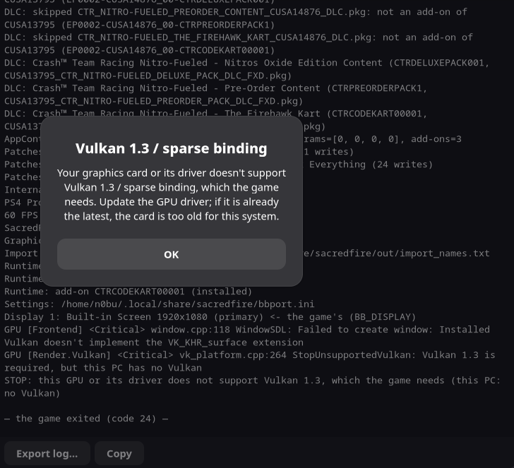

# NVIDIA Vulkan startup error evidence

Screenshot supplied by the reporter for a startup failure on NVIDIA. The application fails to create its window and exits with code 24.



The dialog is titled **Vulkan 1.3 / sparse binding** and reports that the graphics card or driver does not support the required Vulkan features.

Visible log excerpts:

```text
GPU [Frontend] <Critical> window.cpp:118 WindowSDL: Failed to create window: Installed
Vulkan doesn't implement the VK_KHR_surface extension
GPU [Render.Vulkan] <Critical> vk_platform.cpp:264 StopUnsupportedVulkan: Vulkan 1.3 is
required, but this PC has no Vulkan
STOP: This GPU or its driver does not support Vulkan 1.3, which the game needs (this PC:
no Vulkan)

— the game exited (code 24) —
```

NVIDIA is identified by the reporter; the screenshot does not show the GPU model, driver version, or tested build. The messages document a Vulkan initialization failure but do not establish that the hardware is too old or identify the root cause.

Related context: [upstream PR #143](https://github.com/Ryu7w7/OCTR-NitroFueled-PC/pull/143). This evidence is stored on a separate fork branch.
